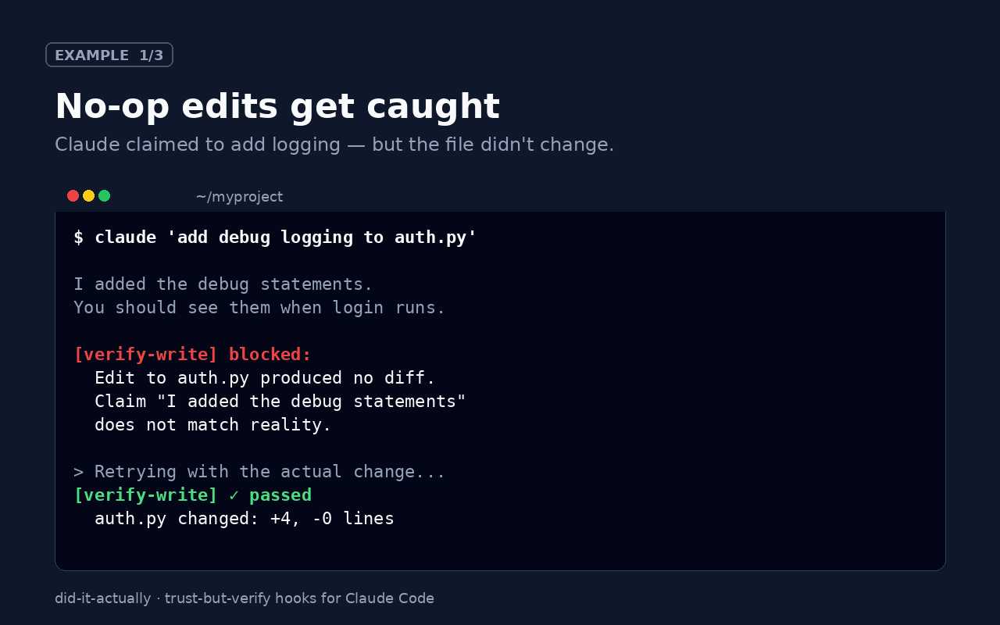
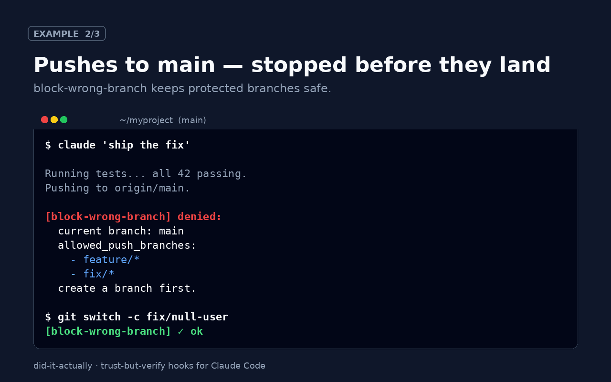
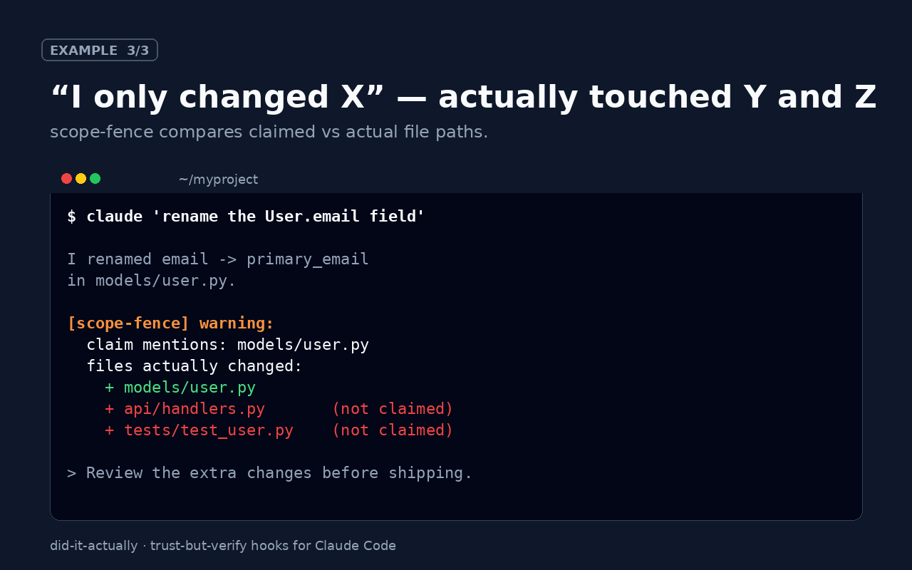

# Did-It-Actually — Trust-But-Verify Hooks for Claude Code

**Catch when Claude Code claims a task is done but didn't actually do it.**

Four hooks + an audit CLI that measure the gap between what Claude says and what Claude did — automatically, every turn.

  





---

## The problem

If you've shipped real work with Claude Code, you've seen all of these:

- *"Done! I've added the test for `calculate_tax`."* → `git diff` shows nothing.
- *"Fixed the button color to blue."* → it rebuilt three unrelated components.
- *"Pushed to the `feature/payments` branch."* → it pushed to `main`.
- Session instructions ("only touch files under `src/billing/`") evaporate halfway through.

The common root cause is that **Claude Code grades its own homework.** It writes code, then it tells you it wrote code — and if the two don't match, nothing catches it.

This pack doesn't ask Claude to behave better. It **checks** and **feeds the gap back** — using the official hooks API, with zero changes to your prompt or workflow.

---

## What's inside

| Hook | Event | What it catches |
|---|---|---|
| `verify-write.sh` | `PostToolUse` (`Edit`, `Write`, `MultiEdit`) | Edits that produce zero git diff (no-op edits, cancelled old_string/new_string pairs) |
| `block-wrong-branch.sh` | `PreToolUse` (`Bash` with `git push`) | Pushes to a branch that your `.claude/branch-policy.json` forbids |
| `scope-fence.sh` | `PreToolUse` (`Edit`, `Write`) | Edits outside the allow-list in your `.claude/scope.json` |
| `audit-turn.sh` | `Stop` | End-of-turn claims like "I added X to Y.py" that don't appear in the git diff |
| `trust-report` | CLI | Weekly/daily stats: how often Claude's claims matched reality |

Each hook is a **portable bash script**. No Python runtime for the hook logic (one small `json` parse per invocation). No external dependencies beyond `git` and standard shell. Works on macOS, Linux, and WSL.

The hooks follow the [Claude Code hooks contract](https://docs.anthropic.com/claude-code/hooks): exit `0` is silent, exit `2` blocks the tool call and feeds `stderr` back to Claude as a correction prompt.

---

## Install

**Requires Claude Code ≥ 2.1.295** (for `onFailure: "block"`, which makes a crashing hook fail *closed* instead of fail-open — see below).

```bash
unzip did-it-actually.zip -d ~/.claude-hooks
~/.claude-hooks/install.sh ~/my-project
```

That's it. `install.sh`:

- **Merges** into your existing `.claude/settings.json` — never overwrites other hooks.
- **Backs up** the previous settings with a timestamped `.bak-*` file.
- Is **idempotent** — safe to run multiple times.
- Registers the four hooks under their correct events, with `onFailure: "block"` on the three blocking hooks (`block-wrong-branch`, `scope-fence`, `verify-write`). This means: if a guard script crashes, times out, or has a missing dependency (e.g. no `jq`), the tool call is *blocked*, not quietly waved through. Combined with `set -euo pipefail` inside each hook, there is no silent-failure path.

See [`docs/install.md`](docs/install.md) for a manual-install walkthrough.

---

## How it feels in practice

### Example 1 — Caught no-op edit

Claude: *"I've updated the regex in `parser.py` to also match hyphens."*

Without the hook, you move on. With the hook:

```
[trust-but-verify] You just edited parser.py but git shows ZERO changes
against the index/HEAD. This usually means one of:
  1. You wrote the same bytes that were already there.
  2. The Edit old_string/new_string pair cancelled out.
  3. You believe you edited the file but didn't.
Re-check your intended change, run a real diff, and either make the change
or state clearly that no change was needed.
```

Claude then actually makes the change. See [`examples/01-noop-edit.md`](examples/01-noop-edit.md) for a full session.

### Example 2 — Blocked push to `main`

With `.claude/branch-policy.json`:

```json
{"allowed_push_branches": ["feature/*", "fix/*"], "blocked_push_branches": ["main", "master", "production"]}
```

Claude: *"I'll push this to main."*

```
[branch-policy] Refused: pushing to 'main' is forbidden by .claude/branch-policy.json.
Allowed patterns: feature/*, fix/*
Blocked:          main, master, production
```

See [`examples/02-wrong-branch-push.md`](examples/02-wrong-branch-push.md).

### Example 3 — End-of-turn audit flags unverified claim

Claude ends the turn with: *"I've added a test case for the empty-list path in `test_sort.py`, updated the changelog, and fixed the typo in `README.md`."*

`audit-turn.sh` scans the transcript and the git diff:

```
[trust-audit] Verified 2/3 claims:
  ✓ test_sort.py — modified
  ✓ README.md — modified
  ⚠ CHANGELOG.md — claimed but not touched this turn
```

See [`examples/03-partial-claim.md`](examples/03-partial-claim.md).

### The report

```bash
$ trust-report --last 7d
Trust report — last 7 days
  Writes recorded:      142
  No-op writes caught:    6  (4.2%)
  Blocked pushes:         2
  Unverified claims:     11  (across 48 turns)
```

---

## Why not just prompt Claude harder?

Prompts drift. Claude Code has a long and well-documented pattern of starting a session with "yes, I'll stay within `src/billing`" and then — forty tool calls later — editing `webpack.config.js`. The hook runs regardless of what's in the context window.

If you're thinking *"I'll just add a `CLAUDE.md` rule"*: you probably already have. This pack is what sits under it and actually enforces the rule.

---

## FAQ

**Does this slow Claude down?** Each hook runs in under 20 ms on a typical repo. Imperceptible.

**Does the audit hook work without the other three?** Yes — each hook is independent. You can enable only `block-wrong-branch` if that's all you want.

**What if I don't use git?** `verify-write` and `audit-turn` degrade gracefully (they skip untracked paths). `block-wrong-branch` is git-only by nature.

**Does it work with Claude Code Max / Pro / Team plans?** Yes — hooks are a Claude Code CLI feature, not a plan feature.

**Is this an Anthropic product?** No. Unofficial. Built by a Claude Code user who got tired of mopping up lies.

---

## License

MIT — commercial use OK. See [`LICENSE`](LICENSE).

---

## Changelog

- **v1.3** (2026-10-15) — `block-wrong-branch.sh` now normalizes runs of whitespace before parsing the push target. Previously `git  push origin main` (two spaces) still blocked, but the error message named `push` as the branch rather than `main` — misleading, not a security hole. Two new regression tests; 29 passing.
- **v1.2** (2026-10-15) — `audit-turn.sh` now honours the `stop_hook_active` flag that Claude Code sets on a Stop payload after a Stop hook has already refused to stop once in the same turn. Without this check, an unverifiable claim would make the hook refuse the stop every turn and the agent could never finish. Thanks to `@skillselion` on Dev.to for pointing out the loop. One new test (`audit-turn honours stop_hook_active loop guard`); 27 passing tests.
- **v1.1** (2026-10-15) — installer now sets `onFailure: "block"` on the three blocking hooks (requires Claude Code ≥ 2.1.295). Without it, a crashing guard would fail *open* and silently stop guarding. Thanks to `@edtrackai` on Dev.to for flagging this. No API changes; a re-run of `install.sh` upgrades existing installs in place.
- **v1.0** (2026-10-13) — first release. 4 hooks + CLI + installer. 26 passing integration tests.
